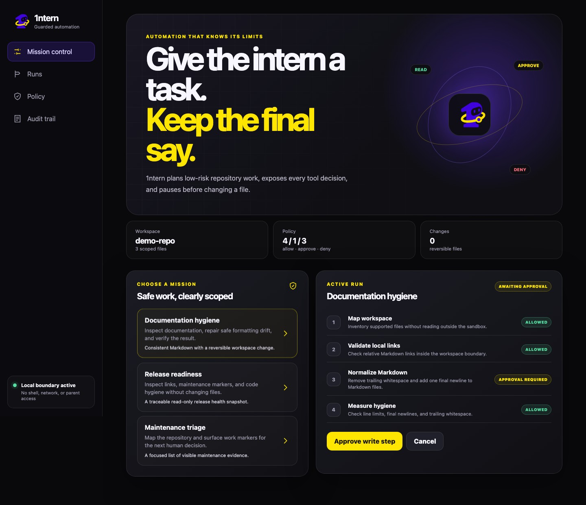
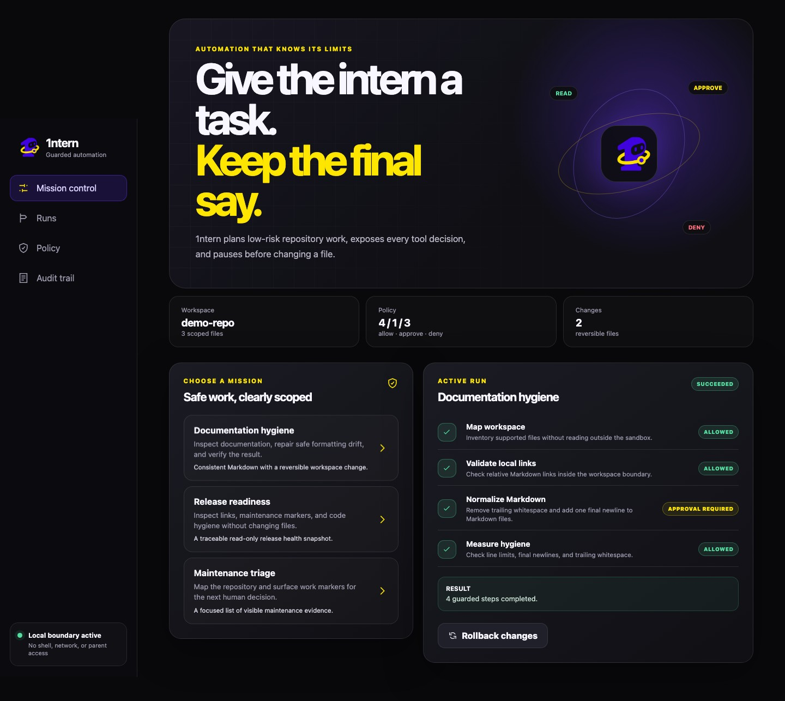
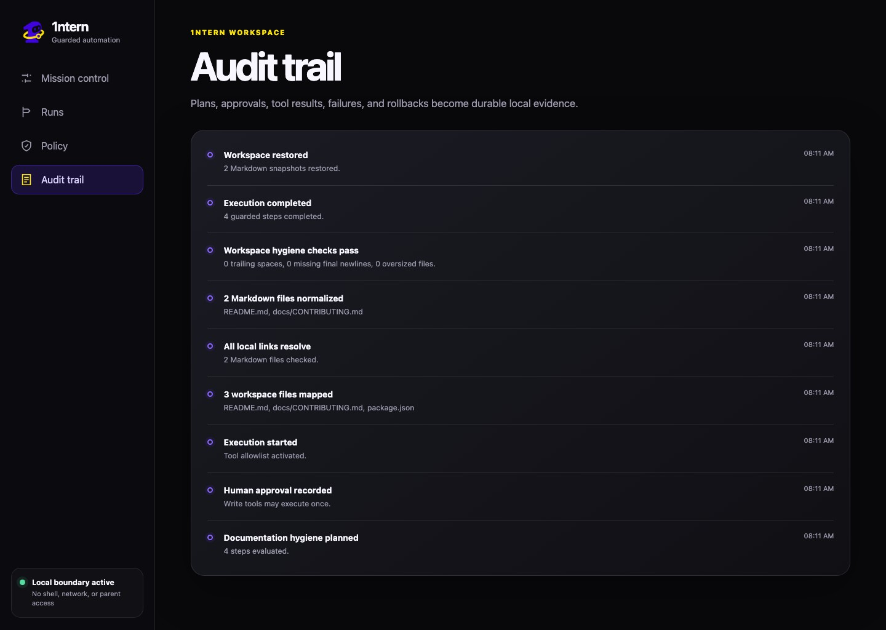
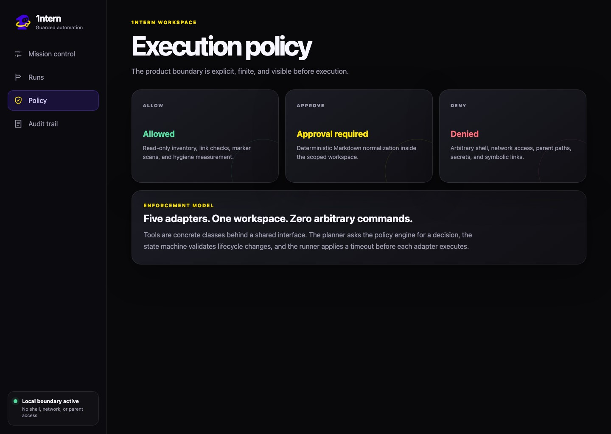
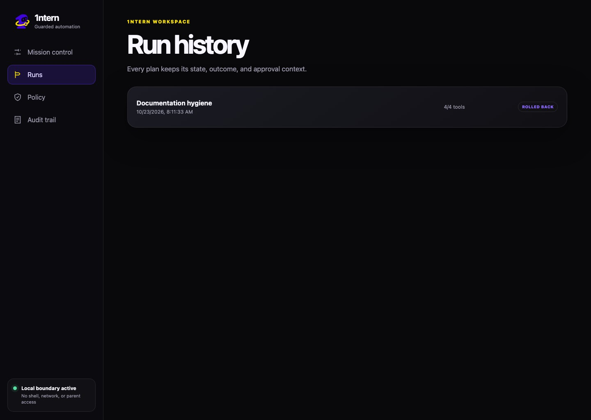
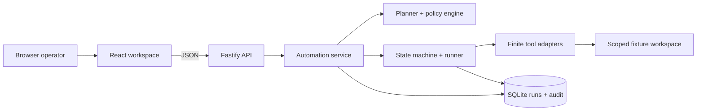

<p align="center">
  
</p>

<p align="center">
  <strong>Capable, with boundaries.</strong><br />
  A guardrailed local automation assistant for low-risk developer maintenance.
</p>

<p align="center">
  <a href="https://github.com/abiekaputra/1ntern/actions/workflows/ci.yml"></a>
  
  
</p>

## The useful intern stops before the risky step

Developer automation usually becomes impressive at the same moment it becomes difficult to trust:
the tool can run anything, but the operator cannot see what will happen next. 1ntern starts from a
smaller promise. Give it a supported maintenance task, inspect the exact tools and policy decisions,
approve any workspace mutation, and keep a durable trace of the result.

The local release can inventory a fixture repository, validate relative Markdown links, scan TODO
and FIXME markers, measure file hygiene, and normalize Markdown. Read-only plans execute directly.
The write adapter pauses for explicit approval, snapshots every target, and exposes rollback after
execution. Arbitrary shell commands, network access, parent paths, secrets, and symbolic links stay
outside the product boundary.

## Product tour

| Review the boundary                                    | Inspect the completed run                                |
| ------------------------------------------------------ | -------------------------------------------------------- |
|  |  |

| Follow durable evidence                        | Read the policy model                            |
| ---------------------------------------------- | ------------------------------------------------ |
|  |  |

| Revisit prior runs                             | Use the workspace on a smaller screen                        |
| ---------------------------------------------- | ------------------------------------------------------------ |
|  |  |

## What users can do

- Choose one of three finite automation intents.
- Review ordered tools, risk levels, and policy reasons before execution.
- Run read-only release and maintenance checks without an approval ceremony.
- Approve a deterministic Markdown write only after its scope is visible.
- Cancel a plan before execution.
- Inspect per-tool results in a persistent SQLite audit trail.
- Roll back every Markdown target from the pre-run snapshot.
- Reset the synthetic workspace and repeat the complete journey locally.

## Architecture



The domain package owns policy, planning, run states, and shared contracts. The API owns
persistence, the filesystem boundary, tool adapters, timeouts, and orchestration. The React client
owns user intent and lifecycle presentation. See [the architecture notes](docs/architecture.md) for
the responsibility map and failure behavior.

### Object-oriented design where behavior varies

`WorkspaceTool` is the polymorphic boundary for tool behavior. Inventory, marker scanning, link
validation, hygiene measurement, and Markdown normalization implement the same contract while
declaring their own risk and mutation behavior. `ExecutionPolicy`, `AutomationPlanner`,
`RunStateMachine`, `AutomationRunner`, and `ScopedWorkspace` each own one decision boundary. This
keeps OOP tied to real variation instead of wrapping data in ceremonial classes.

## Guardrail model

| Decision          | Current capability                                                       | Enforcement                                  |
| ----------------- | ------------------------------------------------------------------------ | -------------------------------------------- |
| Allowed           | Inventory, link validation, marker scan, hygiene measurement             | Read-only adapters inside the workspace root |
| Approval required | Deterministic Markdown normalization                                     | State machine blocks execution until approve |
| Denied            | Shell, network, parent paths, secrets, symbolic links, arbitrary scripts | No adapter exists; path checks reject escape |

The product does not claim to sandbox hostile code. It prevents unsupported behavior by never
providing an arbitrary command surface. Read the complete [security model](docs/security.md).

## Why this stack

| Choice                | Reason                                                                    |
| --------------------- | ------------------------------------------------------------------------- |
| TypeScript            | One strict contract across domain, API, browser, and tests.               |
| React + Vite          | A focused workspace with fast local builds and responsive product states. |
| Fastify + Zod         | Small HTTP surface with runtime request validation.                       |
| Node SQLite           | Durable local traces without a separate database service.                 |
| Explicit tool classes | Each capability declares its risk and execution behavior.                 |
| Playwright + Vitest   | Domain, API, failure, lifecycle, and real-browser validation.             |

## Run locally

### Prerequisites

- Node.js 24
- pnpm 11

```bash
git clone https://github.com/abiekaputra/1ntern.git
cd 1ntern
corepack enable
pnpm install
cp .env.example .env
pnpm setup:local
pnpm dev
```

Open [http://127.0.0.1:4500](http://127.0.0.1:4500). The API listens on
`http://127.0.0.1:4501`. `pnpm dev` builds the three workspaces before starting their local preview
processes, so no file watcher is required.

## Environment

| Variable                   | Purpose                               | Default                          |
| -------------------------- | ------------------------------------- | -------------------------------- |
| `ONEINTERN_DATABASE_PATH`  | SQLite run and audit database         | `./runtime/1ntern.db`            |
| `ONEINTERN_WORKSPACE_ROOT` | Only filesystem root tools may access | `./runtime/workspaces/demo-repo` |
| `ONEINTERN_API_PORT`       | Loopback API port                     | `4501`                           |
| `ONEINTERN_LOG_LEVEL`      | Fastify structured log level          | `info`                           |
| `ONEINTERN_RESET_ON_START` | Test-only deterministic reset switch  | `false`                          |
| `VITE_API_PROXY_TARGET`    | Local web-to-API proxy target         | `http://127.0.0.1:4501`          |

## Commands

```bash
pnpm setup:local       # reset the synthetic repository and local database
pnpm dev               # build and run the local API and web workspace
pnpm test              # domain and API suites
pnpm test:e2e          # browser approval, execution, rollback, audit, mobile
pnpm quality           # formatting, limits, secrets, lint, types, tests, build
pnpm capture:screenshots
```

## API surface

| Method | Path                     | Purpose                         |
| ------ | ------------------------ | ------------------------------- |
| GET    | `/health`                | Local runtime health            |
| GET    | `/api/dashboard`         | Workspace, intents, runs, audit |
| POST   | `/api/runs`              | Create a policy-evaluated plan  |
| POST   | `/api/runs/:id/approve`  | Record explicit write approval  |
| POST   | `/api/runs/:id/execute`  | Execute the valid plan          |
| POST   | `/api/runs/:id/cancel`   | Cancel before execution         |
| POST   | `/api/runs/:id/rollback` | Restore the saved snapshot      |

## Validation record

- Eleven domain and API tests pass.
- Three Chromium journeys pass through approval, execution, rollback, audit, and mobile layout.
- The quality gate enforces Prettier, linting, strict types, credential scanning, directory limits,
  production file limits, tests, and a production build.
- Six JPG product captures come from the running release.

See [testing](docs/testing.md) for the covered failure cases and [screenshot documentation](docs/screenshots.md)
for the user-facing evidence.

## Honest boundaries

- Local-only, single-operator portfolio release.
- One synthetic fixture workspace; arbitrary repositories are not accepted in v1.
- Five built-in tools and three supported intents.
- No shell execution, package installation, network access, Git mutation, or secret handling.
- Synchronous short-running tools with a three-second per-tool timeout.
- Rollback covers files targeted by the current Markdown write adapter.
- SQLite audit history is local evidence, not an append-only compliance ledger.

## License

[MIT](LICENSE)
