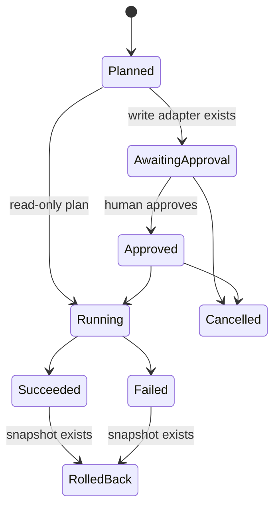

# Architecture

## Responsibility map

| Layer              | Responsibility                                                       |
| ------------------ | -------------------------------------------------------------------- |
| React web          | Intent selection, plan review, lifecycle controls, evidence views    |
| Fastify API        | Validation, loopback HTTP boundary, error translation                |
| Automation service | Use-case orchestration and dashboard projection                      |
| Planner + policy   | Ordered tool plan and allow/approve/deny decisions                   |
| Run state machine  | Legal lifecycle transitions                                          |
| Automation runner  | Sequential execution, timeouts, snapshots, terminal outcomes         |
| Tool adapters      | One concrete, declared maintenance behavior each                     |
| Scoped workspace   | Canonical path checks, symlink exclusion, reads, writes, restoration |
| SQLite repository  | Runs, plan steps, snapshots, and audit events                        |

## Execution lifecycle

Every transition is validated by `RunStateMachine`. A request cannot execute an awaiting-approval
run, repeat a terminal run, cancel after execution, or roll back a run without a snapshot.

## Adapter contract

Each `WorkspaceTool` declares an identifier, title, description, risk, mutation flag, and an async
execution method. The policy operates on that metadata before the adapter is reachable. The runner
looks tools up only in its injected allowlist and wraps each call in a three-second abort timeout.

The release includes four read adapters and one write adapter. Adding another capability requires
a new concrete implementation, policy-visible metadata, intent wiring, and tests; a browser user
cannot expand the tool set at runtime.

## Persistence

SQLite stores the whole plan as validated JSON with lifecycle metadata. Audit events are separate
ordered rows, which makes tool evidence easy to query without rebuilding the run. A write run stores
one JSON snapshot before mutation. Rollback restores the captured paths and terminates the run in
`rolled_back`.

## Failure handling

- Request schemas reject missing, oversized, or unsupported intent identifiers.
- Missing tools fail the run instead of being skipped.
- A denied policy decision stops execution.
- Tool exceptions and timeouts produce a terminal failed run and an audit event.
- UI controls remain disabled while a lifecycle request is in flight.
- API errors appear in a visible alert without erasing the active plan.
